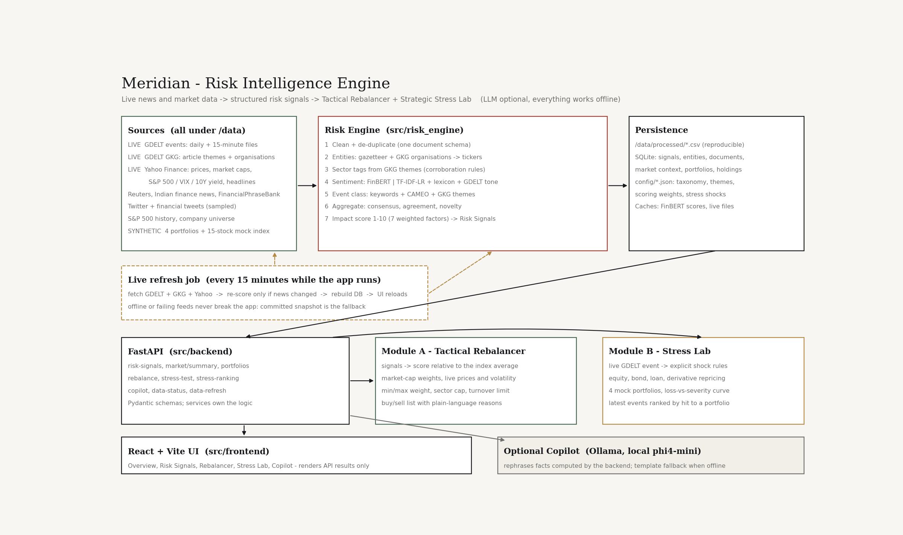
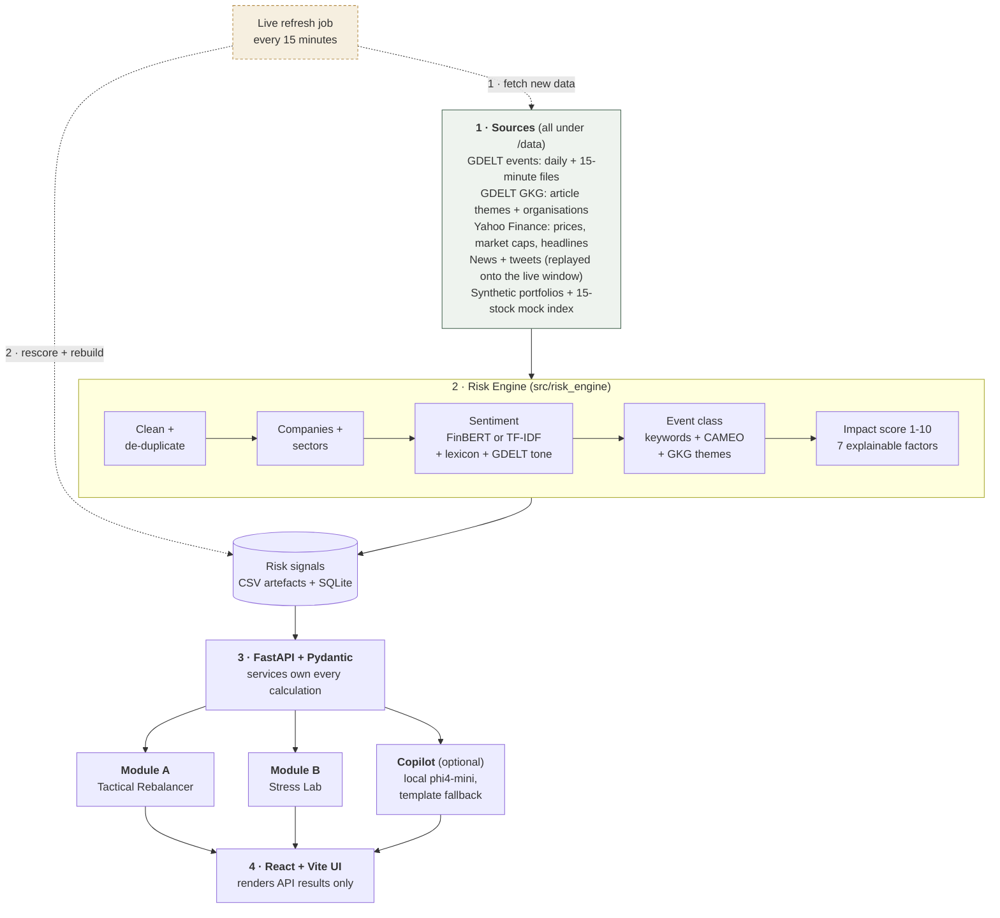

# Meridian - Real-Time Risk Intelligence Engine

**S&P Global & Crisil Campus Hackathon 2026** · Case study: *AI/NLP Risk Engine with downstream Tactical Rebalancing (Module A) and Strategic Stress Testing (Module B)*

| | |
|---|---|
| Candidate | Pavithra K R |
| College | Vellore Institute of Technology, Chennai |
| Demo video | https://vimeo.com/1234679155?fl=tl&fe=ec |
| Slide deck | [docs/presentation.pptx](docs/presentation.pptx) |
| Architecture | [docs/architecture.png](docs/architecture.png) · deeper notes in [design.md](design.md) |

---

## 1. Project Overview / Problem Statement & Approach

**Problem.** Risk signals live in unstructured text — news, social posts, global event feeds — but portfolios need structured, numeric, explainable inputs. The brief asks for an AI/NLP Risk Engine that turns text into *sentiment, event classification and impact score*, and at least one downstream module that uses them.

**Approach.** We built the engine **and both downstream modules**, as a real data product rather than an LLM wrapper:

1. **Risk Engine** — live GDELT events (enriched with GDELT's own article themes and organisations), plus Reuters, Indian finance news, FinancialPhraseBank, two Twitter corpora and Yahoo Finance headlines, pass through one pipeline: clean → de-duplicate → entity/ticker normalisation → ensemble sentiment (FinBERT *or* a locally trained TF-IDF model, plus a risk lexicon and GDELT tone) → event classification → source aggregation → deterministic 1–10 impact scoring → **Risk Signals**.
2. **Module A – Tactical Rebalancer** — a hypothetical 15-stock index (real market-cap weights, live prices) re-weighted from company, sector and macro signals under weight, sector-cap and turnover constraints. Answers "what to buy and sell, and why", with the weights' day-by-day path.
3. **Module B – Strategic Stress Lab** — four materially different *synthetic* portfolios (equities, bonds, loans, derivatives). Pick a live GDELT event (or define a what-if); explicit, configurable shock rules are applied to every position. Shows loss by asset class, sector and driver, the same event across all four portfolios, a loss-versus-severity curve with break-even points, and the latest events ranked by their hit to the selected portfolio.
4. **Optional AI Copilot** — a chat interface over the facts the backend has already computed. A local Ollama model (we use `phi4-mini`) only rephrases them; without Ollama every screen still works and the copilot answers from built-in templates.

Key insight made visible in the UI: **the risk of an event is not universal — it depends on exposure.** The same geopolitical event costs the growth fund roughly 8% and the conservative fund under 1%.

## 2. Architecture & Tech Stack



**Data flow.** Solid arrows are the main path from raw data to the screen; dotted arrows are the background refresh job that keeps everything current.



| Layer | Where | What it does |
|---|---|---|
| Data preparation | `data/`, `src/data_prep/` | GDELT, GKG and Yahoo Finance fetchers; seeded generator for the synthetic portfolios |
| Risk Engine | `src/risk_engine/` | Cleaning, company and sector detection, sentiment, event class, impact score, Risk Signals |
| Storage | `data/processed/`, SQLite | Pipeline outputs as CSV, the database built from them, the trained sentiment model |
| Backend | `src/backend/` | FastAPI routes, Pydantic schemas, services, the live refresh job |
| Module A | `src/modules/rebalancer/` | Stock scoring, weight, sector and turnover constraints |
| Module B | `src/modules/stress_testing/` | Shock rules and repricing of stocks, bonds, loans and derivatives |
| Frontend | `src/frontend/` | React pages and charts; no financial logic, only what the API returns |

* **Backend:** Python 3.10, FastAPI, Pydantic, SQLite, pandas / NumPy / SciPy, scikit-learn.
* **NLP:** FinBERT (Hugging Face, optional) · local TF-IDF + logistic-regression sentiment (trained on FinancialPhraseBank + financial tweets) · risk lexicon · gazetteer entity linker · GDELT GKG theme/organisation enrichment · weighted-keyword + CAMEO + theme event classifier.
* **Live data:** GDELT daily and 15-minute files, GKG, and Yahoo Finance via yfinance — all optional, with a committed snapshot as fallback.
* **Frontend:** React 18, Vite, hand-written SVG charts and CSS (Cormorant Garamond + Hanken Grotesk, bundled locally — no CDN).
* **LLM (optional):** Ollama with a local chat model (`phi4-mini` here).

## 3. Dataset Used

Everything the prototype reads is in [`/data`](data); the app needs no API key or login. Sources, licences and which files are generated: [data/README.md](data/README.md).

| Folder | Content | Source |
|---|---|---|
| `gdelt-recent/` | GDELT 1.0 daily event exports (27 Sep – 8 Oct and growing; new days download automatically) | [GDELT Project](https://www.gdeltproject.org/) |
| `gdelt-themes/` | Compact GKG enrichment per day: article themes and organisations matched to our companies | GDELT Project (built by `src/data_prep/fetch_gkg.py`) |
| `news/` | FinancialPhraseBank, Reuters Finance News, Indian Finance News (a 5,000-article sample, shipped as `-sample.csv`) | Public corpora |
| `social/` | Twitter_Data (general sentiment, sampled), financial-tweets-senti | Public corpora (Hugging Face `zeroshot/twitter-financial-news-sentiment`) |
| `market/` | S&P 500 constituents 2025, S&P 500 index history, and `yfinance/` live prices, market caps and headlines | Public price data; Yahoo Finance via yfinance |
| `reference/` | Company universe: ticker, name, sector, aliases | Curated (public facts) |
| `config/` | Event taxonomy, GKG theme mapping, scoring weights, **stress shock assumptions**, rebalancer limits | Authored |
| `portfolios/` | 4 **synthetic** portfolios, holdings, 15-stock mock index | Generated by `src/data_prep/generate_portfolios.py` (seeded) |
| `processed/` | Pipeline outputs (risk signals, scored documents, market context, SQLite DB, sentiment model) | Generated by the pipeline |

### Sources and citations

| Data / model | Used for | Link and reference |
|---|---|---|
| GDELT events and GKG | The live news stream, article themes and organisations | [gdeltproject.org](https://www.gdeltproject.org/) · [event files](http://data.gdeltproject.org/events/index.html) · Leetaru & Schrodt (2013), *GDELT: Global Data on Events, Location and Tone, 1979–2012*, ISA Annual Convention |
| FinancialPhraseBank | Trains and evaluates the local sentiment model | [Kaggle: Sentiment Analysis for Financial News](https://www.kaggle.com/datasets/ankurzing/sentiment-analysis-for-financial-news) · [Hugging Face: takala/financial_phrasebank](https://huggingface.co/datasets/takala/financial_phrasebank) · Malo et al. (2014), *Good debt or bad debt*, JASIST 65(4) |
| Financial tweets sentiment | Trains the sentiment model; social source | [Hugging Face: zeroshot/twitter-financial-news-sentiment](https://huggingface.co/datasets/zeroshot/twitter-financial-news-sentiment) |
| Twitter and Reddit sentiment (tweets file) | Generic social text | [Kaggle: Twitter and Reddit Sentimental analysis Dataset](https://www.kaggle.com/datasets/cosmos98/twitter-and-reddit-sentimental-analysis-dataset) |
| Indian financial news | News source (5,000-article sample) | [Hugging Face: kdave/Indian_Financial_News](https://huggingface.co/datasets/kdave/Indian_Financial_News) |
| Reuters finance news (2006–2013) | News source (1,000-article sample) | [Hugging Face: danidanou/Reuters_Financial_News](https://huggingface.co/datasets/danidanou/Reuters_Financial_News). Reuters content remains Reuters' copyright |
| S&P 500 daily prices, 2025 | Snapshot prices, volatility, beta, covariance | [Hugging Face: mospira/sp500-daily-candles-2025](https://huggingface.co/datasets/mospira/sp500-daily-candles-2025) |
| S&P 500 index history | Volatility-percentile history | [Hugging Face: misikoff/SPX](https://huggingface.co/datasets/misikoff/SPX) |
| Live prices, market caps, headlines | Live market layer | [Yahoo Finance](https://finance.yahoo.com/) through [yfinance](https://github.com/ranaroussi/yfinance) |
| FinBERT (model) | Optional sentiment backend | [ProsusAI/finbert](https://huggingface.co/ProsusAI/finbert) · Araci (2019), *FinBERT*, [arXiv:1908.10063](https://arxiv.org/abs/1908.10063) |
| phi4-mini (model) | Optional copilot wording | [Ollama library: phi4-mini](https://ollama.com/library/phi4-mini) |

Per-file details, licences and preprocessing: [data/README.md](data/README.md).

**Live versus replayed (stated openly).** GDELT events keep their real dates and are fetched up to the current day (15-minute files for the day not yet covered by a daily export). The older text corpora (Reuters 2006–13, COVID-era Indian news, tweets) are spread deterministically over the completed days of the same window so the product behaves like a continuous stream; their original dates are kept in `original_date`. Dashboard headline figures and the Stress Lab event list use live GDELT events only. Equity prices, market caps and volatility are live from Yahoo Finance; bonds, loans, derivatives and all portfolio holdings are synthetic.

## 4. Quickstart & Installation

Requirements: Python 3.10 and Node 18+ (Node only to rebuild the UI). A virtualenv `venv/` is assumed.

```bash
# 1. Python dependencies
py -3.10 -m venv venv
venv\Scripts\activate                 # Windows   (Linux/macOS: source venv/bin/activate)
pip install -r requirements.txt

# 2. (Optional) rebuild artefacts from the raw data - processed files are already committed
python -m src.data_prep.generate_portfolios            # synthetic portfolios + mock index
python -m src.risk_engine.pipeline --sentiment tfidf   # ~2 min; use `--sentiment finbert` for FinBERT (needs torch + transformers)
python -m src.backend.db.build                         # SQLite from /data (also built automatically on first start)

# 3. Run API + UI on one port
uvicorn src.backend.main:app --port 8000               # open http://localhost:8000
```

Frontend development with hot reload (run the backend above in a second terminal):

```bash
cd src/frontend
npm install
npm run dev          # http://localhost:5173 (proxies /api to :8000)
npm run build        # production build served by FastAPI
```

Tests: `pytest -q` (scoring, constraints, stress reconciliation, API).

### Live data (automatic while the app runs)

Every time `uvicorn` starts — and then every 15 minutes — a background job:

1. fetches new **GDELT** daily files, and GDELT 2.0 **15-minute files** for the day the daily export doesn't cover yet (stored transiently in `data/gdelt-live/`, replaced by the daily file once published);
2. fetches the matching **GKG** themes and organisations;
3. refreshes **Yahoo Finance** data (daily prices, ~15-min-delayed quotes, market caps, headlines, S&P 500, VIX, US 10-year yield) via `yfinance` (installed by `requirements.txt`; switch off with `MARKET_LIVE=0`);
4. re-scores through the Risk Engine only if the news changed (price-only changes just refresh the market tables), rebuilds the database, and the UI reloads itself. A banner shows progress while this runs.

Offline or failing downloads never break the app: it keeps using the committed snapshot. GDELT publishes a day's file on the following day, so the live view is ~15–30 minutes behind real time.

| Setting (environment variable) | Effect |
|---|---|
| `GDELT_REFRESH_MINUTES=30` | Re-check interval while running (default 15; `0` = startup only) |
| `GDELT_AUTOFETCH=0` | Turn all automatic fetching off |
| `MARKET_LIVE=0` | Turn off Yahoo Finance only |
| `OLLAMA_MODEL`, `OLLAMA_URL` | Choose the copilot model / server |

Manual controls: `python -m src.data_prep.fetch_gdelt`, `python -m src.data_prep.fetch_gkg`, `python -m src.data_prep.fetch_market --force`, or `curl -X POST localhost:8000/api/data-refresh` (status: `GET /api/data-status`).

### Optional copilot (Ollama setup, 3 steps)

The copilot works without any model (it answers from built-in templates). To let a local model phrase the answers:

```bash
# 1. Install Ollama from https://ollama.com (on Windows/macOS it then runs in the background;
#    on Linux start it with:  ollama serve)

# 2. Download a chat model (about 2.5 GB, one time)
ollama pull phi4-mini

# 3. Check it is installed, then (re)start the app
ollama list
uvicorn src.backend.main:app --port 8000
```

The header then shows **Copilot online · phi4-mini**. The first answer after starting Ollama can take ~10 seconds while the model loads.

- Another model: `ollama pull llama3.2`, then set `OLLAMA_MODEL=llama3.2` before starting the app (`OLLAMA_URL` if Ollama is not on `localhost:11434`).
- Only chat models are used; extraction and embedding models (for example `nuextract`) are skipped automatically.
- The model never calculates anything: it only rephrases figures the backend already computed. If Ollama is off or a call fails, the built-in answer is shown.

### API

Interactive docs at `/docs`. `GET /api/health`, `/api/data-status`, `/api/market/summary[?date=YYYY-MM-DD]`, `/api/risk-signals[?event_type&min_impact&sentiment&source_type&q&sort]`, `/api/risk-signals/{id}`, `/api/portfolios[/{id}]`, `/api/stress-scenarios`, `/api/stress-ranking?portfolio_id=`, `POST /api/rebalance`, `/api/stress-test`, `/api/copilot`, `/api/data-refresh`.

## 5. Key Results & Domain Impact

Figures below are from the run of 9 Oct 2026 (they grow as the live feed adds data; `data/processed/pipeline_summary.json` holds the latest).

* **47,814 documents → 5,029 structured risk signals** across 27 Sep – 9 Oct (21 with impact ≥ 7). Each signal carries sentiment (−1…1), event class, impact 1–10, confidence, source consensus, a factor breakdown and affected companies and sectors.
* **Sentiment:** the shipped run used FinBERT inside the ensemble. Held-out accuracy / macro-F1 (`data/processed/sentiment_model_eval.json`): locally trained TF-IDF-LR **0.74 / 0.73**; zero-shot FinBERT **0.56 / 0.54** on the same kind of test data. The TF-IDF model is the stronger in-domain classifier; FinBERT adds an independent, pretrained view.
* **Impact scoring is deterministic and explainable:** seven weighted factors (severity, sentiment strength, confidence, entity relevance, source consensus, market-volatility regime, novelty). Polarity alone never sets the score.
* **GDELT enrichment:** GKG themes and organisations replaced headline-word guessing for sectors and company mentions, and the dashboard's "top sector" now varies with the news.
* **Module A:** weights 1–15% per stock, sector cap 40%, turnover ≤ 10%; real market-cap starting weights and live-price volatility; recommendations explained in plain language, relative to the index average.
* **Module B:** the same event gives very different outcomes per portfolio; losses decompose into equity, rates, spread, default and volatility drivers; asset-level results reconcile exactly to the portfolio total (tested). The loss-versus-severity curve shows how severe an event type must be to cost a given percentage.
* **Why it matters:** risk and portfolio teams get early, explainable, portfolio-specific warnings from text, with every assumption in a config file and a clear "simplified prototype methodology" label.